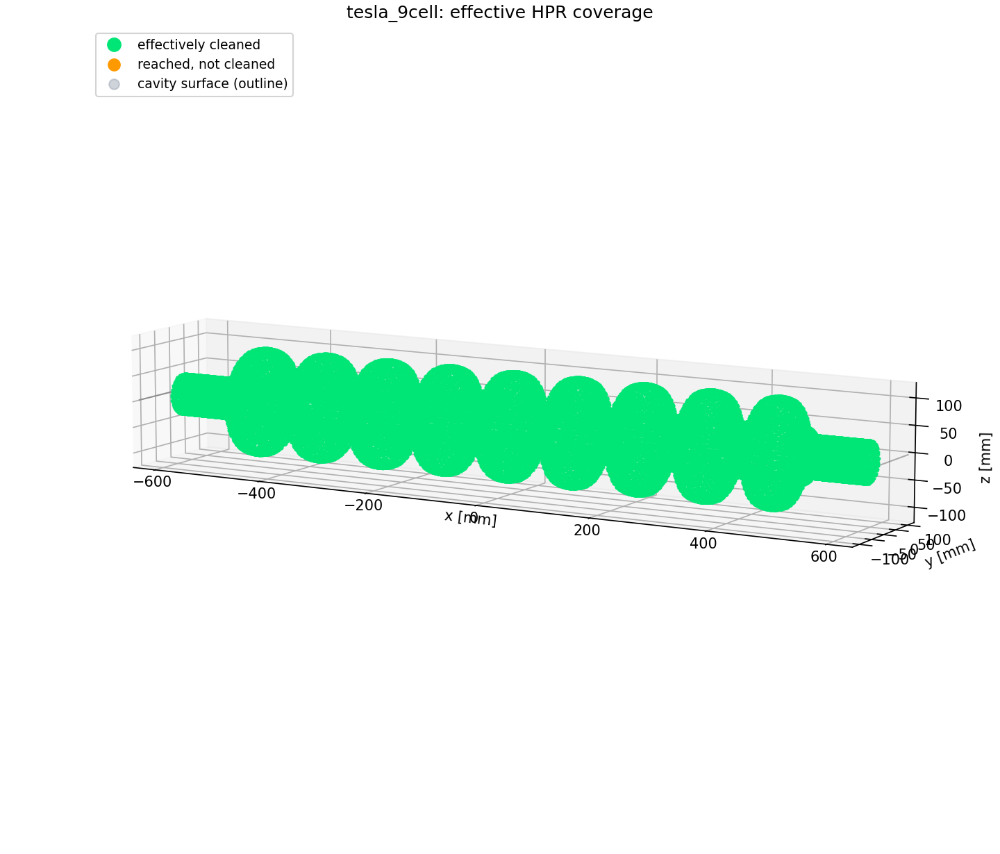
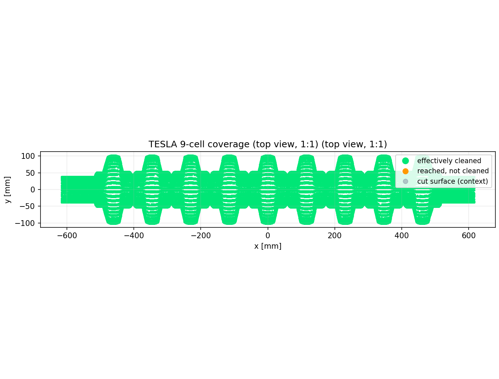
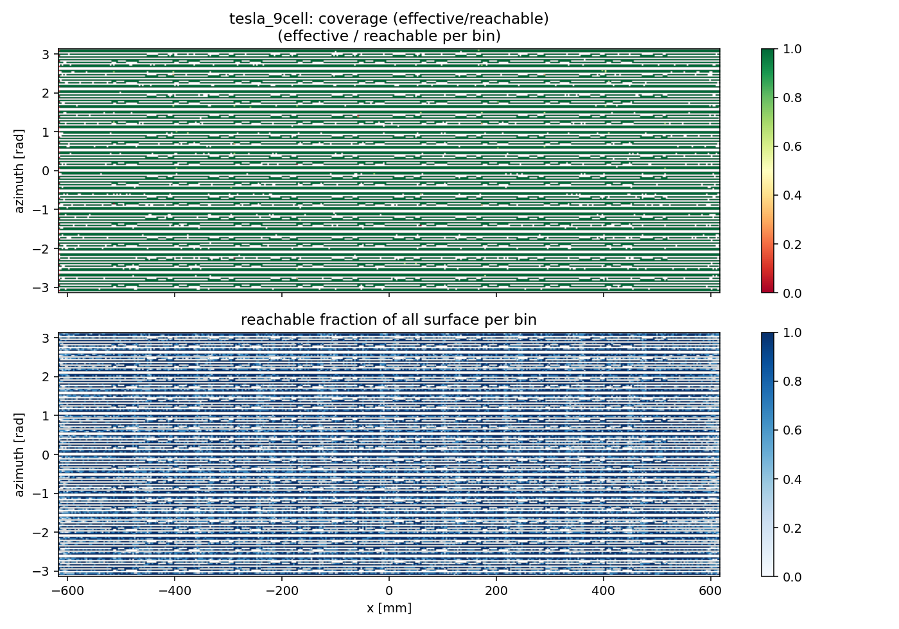
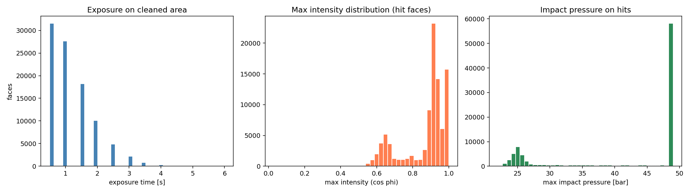
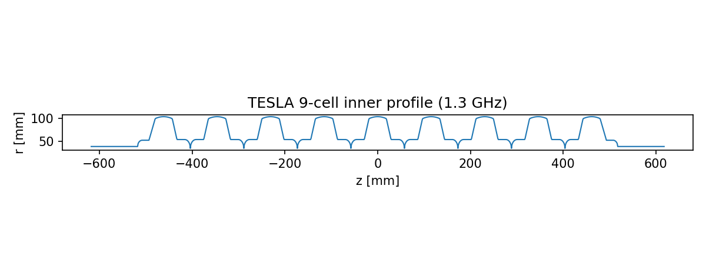

<div align="center">

# hpr-sim

**General-purpose high-pressure rinsing (HPR) coverage simulation
for superconducting RF (SRF) cavities**

[](https://github.com/<org>/hpr-sim/actions)
[](https://pypi.org/project/hpr-sim)
[](LICENSE)

*Predict, before the clean-room run, whether your high-pressure rinsing
process really cleans the inner surface of the cavity.*

</div>

---

`hpr-sim` casts the water jets of an HPR wand onto the STL mesh of any SRF
cavity, evaluates where the wall is actually washed (incidence angle, usable
stand-off, impact force), and returns the **effective cleaning coverage** of
the RF surface — plus coverage maps and per-face data for ParaView.

```bash
pip install -e .
python tools/make_tesla_cavity.py          # build the example 9-cell TESLA cavity
python -m hpr_sim -f examples/tesla_9cell.yaml
```


*Effective HPR cleaning coverage of the 1.3 GHz TESLA 9-cell cavity
(green = effectively cleaned, amber = reached but not cleaned).*

## Highlights

- **Geometry-agnostic** — any cavity expressible as a triangle mesh
  (single / multi-cell, SSR, HWR, QWR, …). STEP files are converted
  automatically with FreeCAD.
- **Auto configuration** — the beam axis, the cell chain and the scan region
  are detected from the mesh (`x_start: auto`), including multi-cell cavities.
- **Physics-aware jet** — Bernoulli exit velocity, intact core +
  atomized droplets with a **Reynolds-dependent drag law**
  (Schiller–Naumann / Morsi–Alexander / Putnam / constant), so the wall
  *impact pressure* is computed instead of a purely geometric footprint.
- **Fast** — vectorised Möller–Trumbore ray casting with two-stage candidate
  culling; tens of thousands of poses per minute on a laptop core.
- **Vivid, honest visualisation** — coverage cloud maps with strict 1:1 axes,
  axial–azimuth maps, histograms; VTK export for ParaView.

## Documentation

| Guide | Link |
|---|---|
| Concepts & physics model | [docs/physics.md](docs/physics.md) |
| YAML configuration reference | [docs/config.md](docs/config.md) |
| Environments & compatibility | [docs/compatibility.md](docs/compatibility.md) |
| Supported Python versions | `3.9 – 3.13` (CI: 3.9–3.12 on Linux/macOS/Windows) |

## Quick start

```bash
# 1. scaffold a configuration
python -m hpr_sim --write-template configs/my_cavity.yaml

# 2. build the example cavity and run it
python tools/make_tesla_cavity.py
python -m hpr_sim -f examples/tesla_9cell.yaml

# 3. parameter sweeps (parallel)
python -m hpr_sim -f examples/tesla_9cell.yaml --sweep threshold,tilt --jobs 4 --fast
```

Outputs land in `data/outputs/`:

| file | content |
|---|---|
| `*_coverage3d.png` / `*_intensity3d.png` | 3-D coverage / intensity clouds |
| `*_unrolled.png` | axial–azimuth coverage map |
| `*_hist.png` | exposure / intensity / impact histograms |
| `*_summary.json` | metrics + parameters |
| `*_coverage.vtk` | per-face data for ParaView |
| `*_sweep_*.csv/.png` | parameter-sweep tables & curves |

## Example benchmark — TESLA 9-cell

| metric | value |
|---|---|
| mesh | 117 408 triangles, water-tight, 0.90 m² |
| geometry | 7 mid cells (R_iris 35 mm) + 2 end cells (39 mm), R_eq 103.3 mm, λ/2 = 115.4 mm |
| effective coverage | **≈ 98.7 %** of the reachable surface (100 bar, 6×25°, 10 mm/s, 24 rpm) |
| reachable inner surface | ≈ 86 % of the 0.90 m² wall |
| wall time | ≈ 50 s for the full 9-cell scan (moderate resolution, 1 core) |

### Output gallery

| | |
|---|---|
| Coverage cloud (1:1 scale) |  |
| Half-cavity top view (strict 1:1) |  |
| Axial–azimuth map |  |
| Histograms |  |
| Half-cell profile (Aune et al.) |  |

## Command line

```
usage: hpr-sim [-h] [-f CONFIG] [--write-template PATH] [--sweep SWEEP]
               [--jobs JOBS] [--fast]
```

## Python API

```python
from hpr_sim.mesh import TriangleMesh
from hpr_sim import geometry
from hpr_sim.config import parse_config_dict
from hpr_sim.config_io import load_config
from hpr_sim.simulate import run_simulation
from hpr_sim.analyze import summarize

mesh = TriangleMesh.from_stl("data/tesla_9cell_inner.stl")
axis = geometry.detect_beam_axis(mesh)
prop = geometry.propose_scan_range(mesh, axis)     # multi-cell aware
p = parse_config_dict(load_config("examples/tesla_9cell.yaml"))
res = run_simulation(mesh, p["water"], p["jet"], p["nozzle"],
                     p["motion"], p["sim"], axis=axis)
print(summarize(mesh, res)["effective_coverage_ratio"])
```

See [examples/](examples/) and [docs/index.md](docs/index.md) for the
notebook-style walk-through and all API details.

## Repository layout

```
hpr-sim/
├── hpr_sim/                # the package
├── tools/                  # make_tesla_cavity.py, Step->STL helpers, replot
├── examples/               # TESLA 9-cell config + quickstart script
├── tests/                  # pytest suite (24 tests)
├── docs/                   # physics, config, compatibility
├── data/                   # generated meshes & outputs (git-ignored)
└── .github/workflows/      # CI (3 OS × Python 3.9–3.12 + smoke)
```

## Contributing

See [CONTRIBUTING.md](CONTRIBUTING.md). Bug reports, new cavity cases,
drag/cleaning-model improvements and CI work are all welcome.

## License

MIT — see [LICENSE](LICENSE). The TESLA cavity shape follows the geometry
published in Aune et al., *Phys. Rev. ST Accel. Beams* **3** (2000) 092001.
